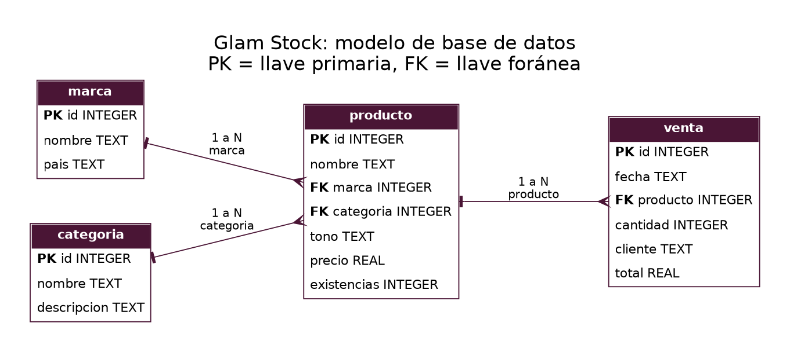
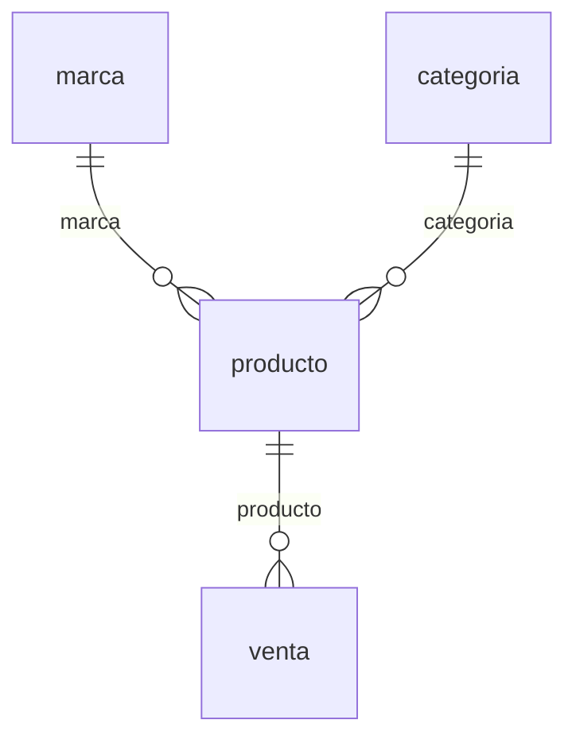

# Glam Stock

Sistema web para administrar el inventario y las ventas de una tienda pequeña de maquillaje.

Proyecto personal del curso de Desarrollo Web. Autor: NOMBRE COMPLETO, sección.

## Tecnologías utilizadas

| Parte | Tecnología |
|---|---|
| Backend | Python 3 + FastAPI |
| Base de datos | SQLite (módulo `sqlite3` de Python) |
| Frontend | HTML, CSS y JavaScript |
| Control de versiones | Git y GitHub |
| Publicación | Vercel |

## Instalación

Se necesita Python 3.9 o superior.

```
git clone URL_DEL_REPOSITORIO
cd glam_stock
python -m venv venv
venv\Scripts\activate
pip install -r requirements.txt
```

En macOS o Linux el entorno se activa con `source venv/bin/activate`.

## Ejecución

```
uvicorn main:app --reload
```

- Aplicación: http://127.0.0.1:8000
- Documentación interactiva de la API: http://127.0.0.1:8000/docs

La base de datos `glam_stock.db` se crea sola la primera vez, con datos de ejemplo.
Para empezar de cero basta con borrar ese archivo y volver a ejecutar.

## Estructura del sistema

```
glam_stock/
├── main.py              Aplicación FastAPI: modelos, reglas de negocio y endpoints
├── database.py          Conexión a SQLite, esquema de tablas y datos de ejemplo
├── public/              Frontend
│   ├── index.html
│   ├── styles.css
│   └── app.js
├── docs/
│   ├── analisis.md      Análisis y diseño del proyecto
│   └── diagrama_er.png  Diagrama entidad-relación
├── glam_stock.db        Base de datos SQLite
├── requirements.txt
└── .gitignore
```

El flujo de la información es:

```
Frontend (public/app.js)  →  API FastAPI (main.py)  →  SQLite (glam_stock.db)
```

## Endpoints de la API

Todas las entidades tienen el mismo CRUD. Ejemplo con `productos`:

| Método | Ruta | Acción |
|---|---|---|
| GET | `/api/productos` | Lista todos los registros |
| GET | `/api/productos/{id}` | Consulta un registro |
| POST | `/api/productos` | Registra uno nuevo |
| PUT | `/api/productos/{id}` | Modifica uno existente |
| DELETE | `/api/productos/{id}` | Elimina un registro |

Rutas disponibles: `/api/marcas`, `/api/categorias`, `/api/productos`, `/api/ventas`. Además, `GET /api/resumen` devuelve estadísticas calculadas con SQL.

Códigos de error: `404` si el registro no existe, `409` si la operación rompe una
relación o una regla del sistema, y `422` si los datos enviados no son válidos.

## Regla de negocio

total = precio del producto × cantidad. Además, cada venta resta sus unidades de `producto.existencias`.

## Base de datos





La descripción completa de tablas, llaves y relaciones está en [docs/analisis.md](docs/analisis.md).

## Publicación en Vercel

1. Subir el proyecto a un repositorio de GitHub.
2. En vercel.com elegir **Add New → Project** e importar el repositorio.
3. Vercel detecta FastAPI por el archivo `requirements.txt` y usa `main.py` como entrada. No hay que configurar nada más.
4. Presionar **Deploy**.

Vercel publica la carpeta `public/` como sitio estático y ejecuta `main.py` como función para las rutas `/api`.

**Limitación conocida:** en Vercel el disco es de solo lectura, excepto la carpeta
temporal `/tmp`. Por eso, cuando el proyecto corre en Vercel, `database.py` crea la
base de datos en `/tmp`. Esa carpeta se limpia cuando el servidor se reinicia, así que
en la versión publicada los datos vuelven a los de ejemplo después de un rato sin uso.
En la computadora los datos sí quedan guardados de forma permanente.
